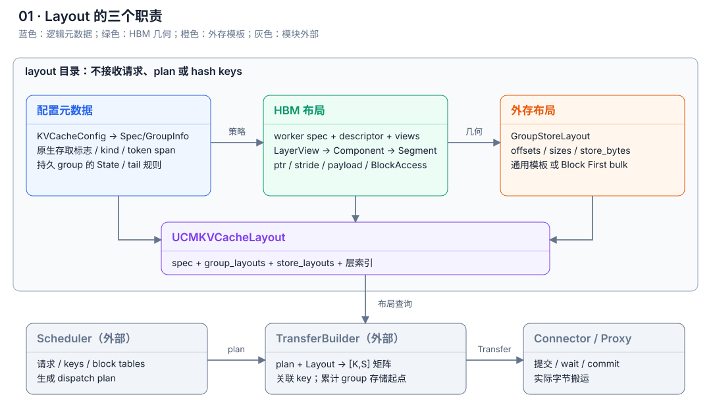
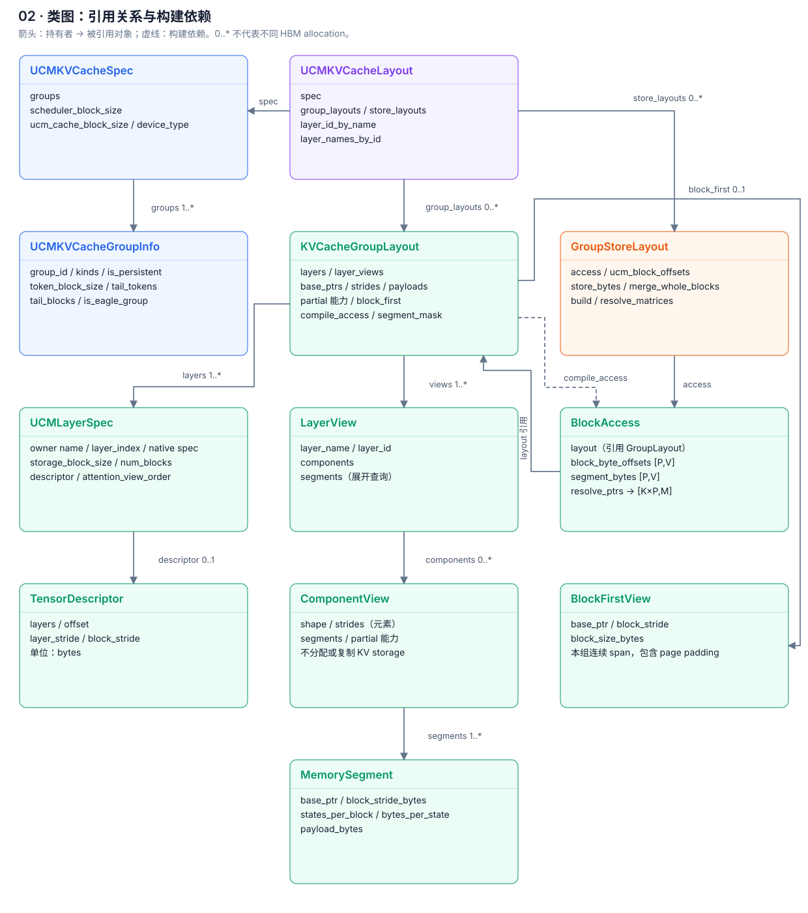
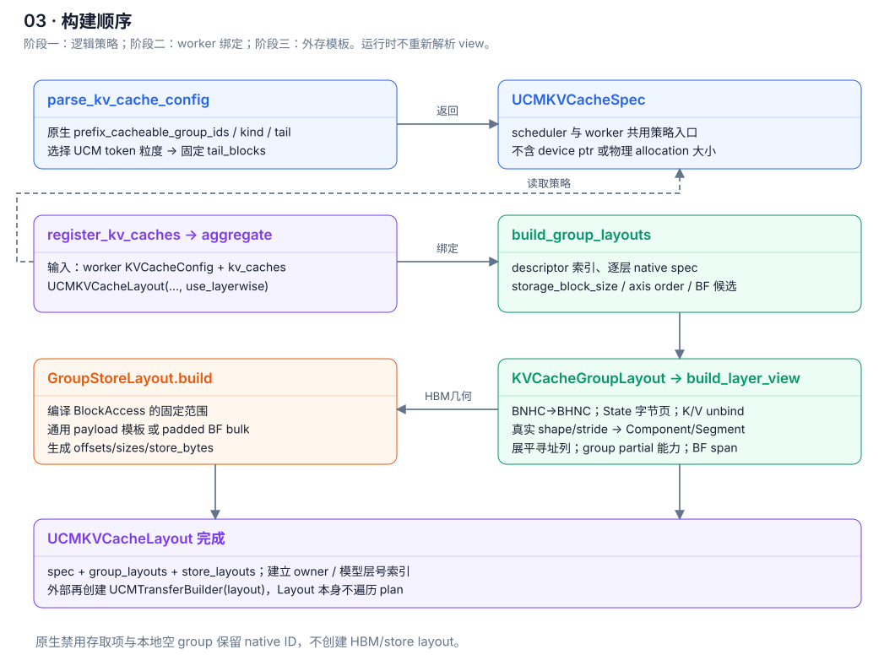
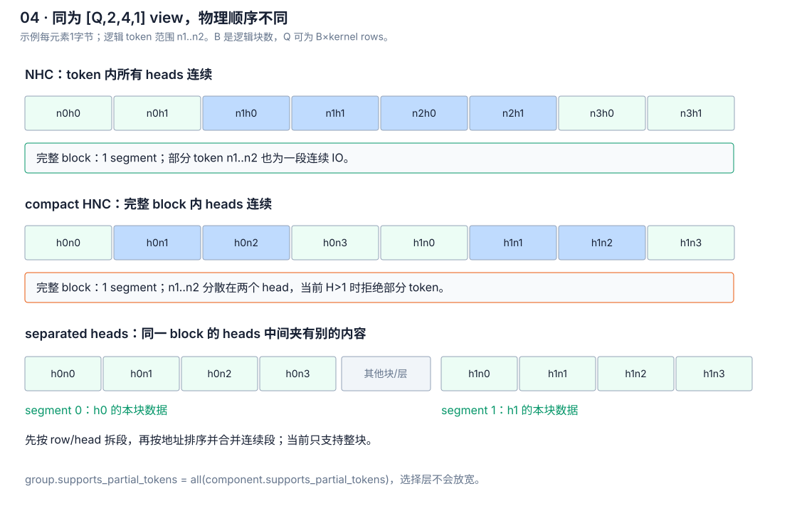
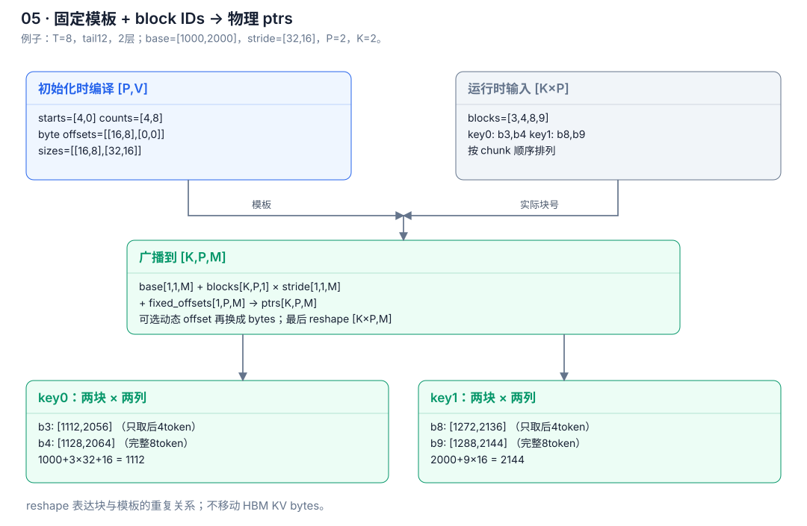
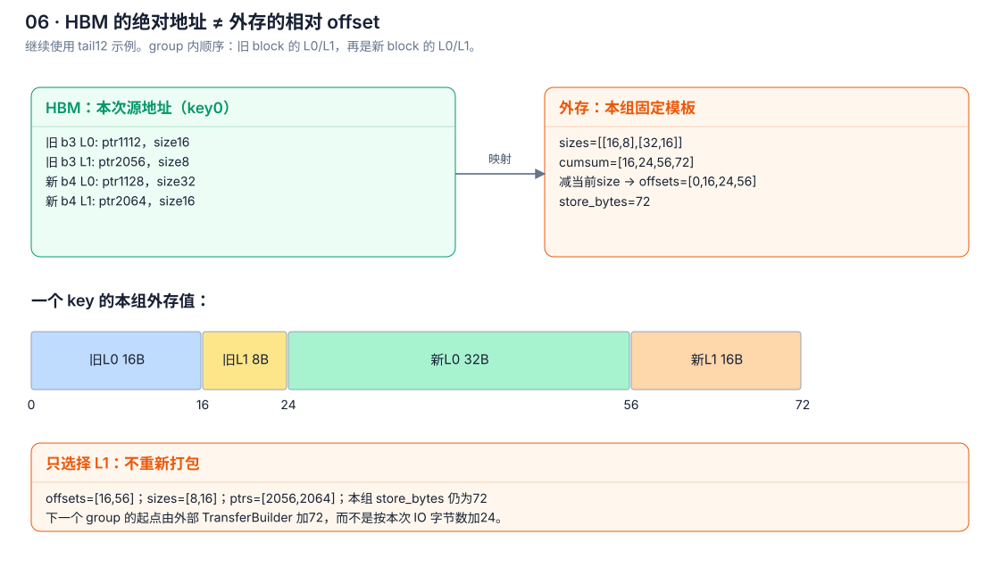
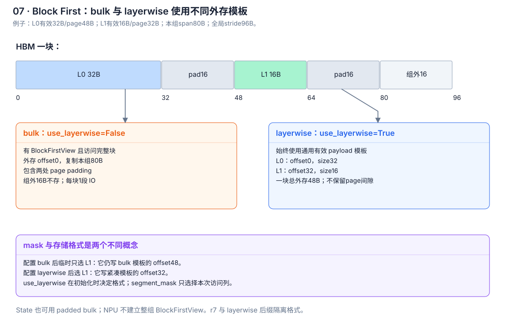
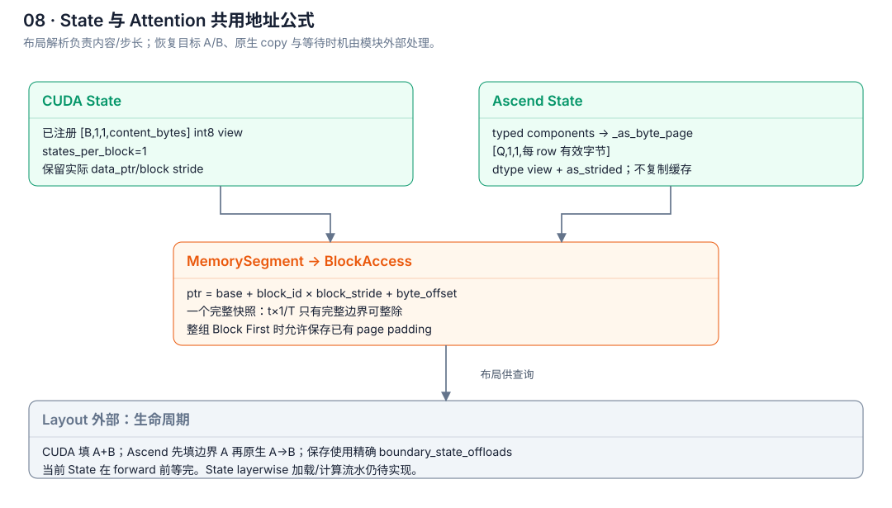
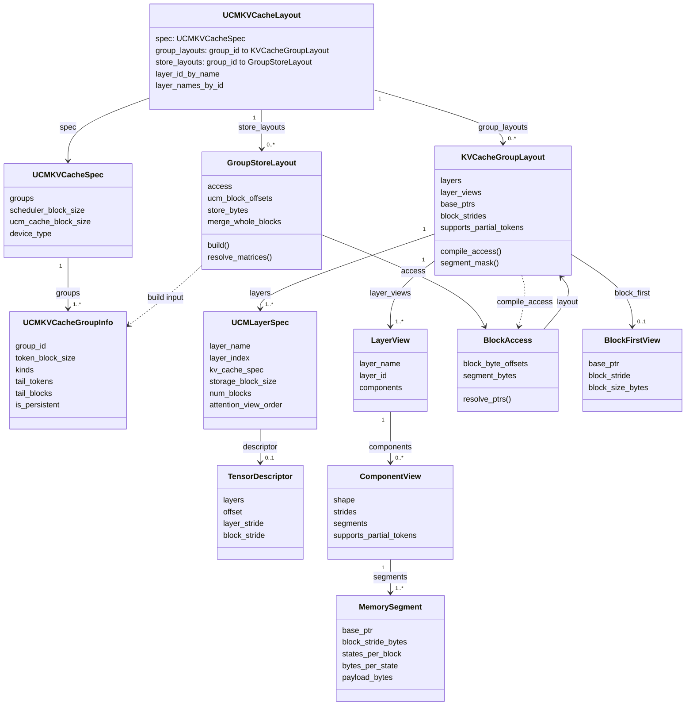

# UCM Connector v2 Layout 详细设计

日期：2026-10-09。本文描述当前源码，阅读对象是需要理解或修改 Layout 的开发者。示例中的层数、地址和字节数均为教学用参数，不是 GLM/Qwen/DeepSeek 的运行时采集结果。

2026-10-12 更新：存取 group 直接使用引擎的 prefix_cacheable_group_ids；删除 UCM 专属 scratch/pool 对齐策略，token offsets/counts 统一为 uint64。仅静态检查，未运行组件或模型测试。

对应代码快照：UCM `117aa5041c769a95cee170992aa1c1e2b91d074b`，基于 `dev_connector@7a22aef59aa6965ec94d920f7371fb7168fec623` 并包含 2026-10-12 的存取 group/uint64 改动。引擎参考：vLLM `v0.30.0@ced6857afa0ea7b2e3f0846a62e1394e90f15607`；Ascend `8fadbe001fe6c26a05b7feeeeb6b1be01fa69d6d` 为原文写作时的源码参考，不代表当前本地 HEAD 或已验证版本。此次发布仅做静态检查，未运行组件或模型测试。v2 使用开发用 `SimpleFileUCMProxy`，生产 store/proxy 尚未接通；当前外存 namespace 为 r7。

图文材料维护在 qyh 的 `docs/v2-layout` 分支；origin 开发分支保留代码、Markdown 说明和阅读链接。

配套文件：[离线 HTML 图文版](connector-v2-layout-design.html)。修改本文后，可运行 `python3 docs/assets/v2-layout/generate.py` 重新生成 SVG/HTML（只用 Python 标准库）。SVG 图不依赖网络；类图的 Mermaid 源码放在附录，便于维护。

## 1. 一张图看清职责

Layout 回答三个问题：这个缓存的逻辑规则是什么？有效字节在 HBM 的哪里？这些字节在外存的哪里？它不拥有请求、hash key、dispatch plan、IO task 或设备计算时序。



| 部分 | 输入 | 输出 | 当前文件 |
| --- | --- | --- | --- |
| 配置元数据 | KVCacheConfig、模型辅助参数、UCM block size | UCMKVCacheSpec、UCMKVCacheGroupInfo | layout/kv_cache.py |
| HBM 布局 | worker 原生 spec/descriptor、真实 kv_caches | UCMLayerSpec、LayerView、ComponentView、MemorySegment、KVCacheGroupLayout | layout/__init__.py、group.py、view.py |
| 外存布局 | group 元数据、HBM 布局、use_layerwise | GroupStoreLayout、固定 offsets/sizes、store_bytes | layout/store_layout.py |
| 布局汇总 | 上述结果 | UCMKVCacheLayout | layout/kv_cache.py |
| 外部调度与传输 | 请求、plan、Layout | key 关联、group 偏移累计、UCMProxyTransfer、任务提交 | ucm_scheduler.py、ucm_kv_cache.py、ucm_connector.py |

这里的“独立”指职责与依赖边界：layout 目录不导入 scheduler/proxy。它仍然理解 vLLM 原生 spec 和 Ascend 的 view ABI，并不是完全脱离引擎的通用张量库。元数据解析入口共用；worker 物理绑定必须使用 worker 的完整 KVCacheConfig，不能从 scheduler 配置猜地址。

配置、HBM 和 store 是三个职责，不要求强制拆成三个文件。现有 group/view 组织继续保留；目录对外统一导出 Layout 对象。

## 2. 类图：对象如何关联



实线表示对象持有或引用，箭头从持有者指向被持有者；虚线表示构建依赖。共享引用不代表唯一所有权或新分配。

| 对象 | 关键字段 | 含义 |
| --- | --- | --- |
| UCMKVCacheSpec | groups、scheduler_block_size、ucm_cache_block_size、device_type | 全局逻辑策略；大小单位为输入 token |
| UCMKVCacheGroupInfo | group_id、token_block_size、kinds、tail_tokens、tail_blocks、is_persistent | 一个原生 group 的存取规则 |
| UCMLayerSpec | layer_name、layer_index、kv_cache_spec、storage_block_size、num_blocks、descriptor、attention_view_order | worker 中一个注册 owner 的声明；包含物理绑定信息 |
| TensorDescriptor | layers、offset、layer_stride、block_stride | 引擎对 backing 内放置方式的声明，stride 单位为字节 |
| LayerView | layer_name、layer_id、components | 一个 layer_name 对应一个或多个 component；不分配 KV buffer |
| ComponentView | shape、strides、segments、supports_partial_tokens | 一个规范化的四维 view 及其连续段；strides 仍以元素计 |
| MemorySegment | base_ptr、block_stride_bytes、states_per_block、bytes_per_state、payload_bytes | 可以连续搬运的一段；地址和大小单位为字节 |
| KVCacheGroupLayout | layers、layer_views、各 segment 数组、supports_partial_tokens、block_first | 一个 group 的物理寻址对象 |
| BlockAccess | layout、block_byte_offsets、segment_bytes | 固定 token 范围编译后的访问模板 |
| BlockFirstView | base_ptr、block_stride、block_size_bytes | 本组一个完整 block 的连续 span，允许组内 page padding |
| GroupStoreLayout | access、ucm_block_offsets、store_bytes、merge_whole_blocks | 单个 group 在外存中的模板；offset 从本组起点计 |
| UCMKVCacheLayout | spec、group_layouts、store_layouts、层索引 | 统一汇总入口；不解释 plan |

UCMLayerSpec 的 layer_index 是模型层编号，layer_name 是注册缓存 owner 名。attention、indexer、compressor 可能同属一个模型层，却拥有不同 layer_name、spec、buffer 或 group。索引不能直接等同于“第几列 segment”。

## 3. 先统一符号和数组维度

全文使用以下符号；它们是解释符号，不要求修改代码变量名。

| 符号 | 意义 | 对应关系 |
| --- | --- | --- |
| B | 原生逻辑 block 数量 | UCMLayerSpec.num_blocks |
| Q | 一个规范化 tensor view 的第一维 | 可能为 B，也可能为 B×R |
| R | 一个逻辑 block 占多少个 kernel row | Q // B；源码 view helper 中叫 rows |
| H | view 的 head 轴宽度 | State 规范化后为1；HiddenState 的 H 可表示采集层数量 |
| N | 一个 kernel row 中的 stored-state 条数 | 有压缩时不等于输入 token 数 |
| C | 每个 head/state 的 channel 宽度 | State 字节页中表示有效内容字节数 |
| T | 一个逻辑 block 表示的输入 token 范围 | group.token_block_size |
| U | 一个 UCM key 对应的输入 token 范围 | spec.ucm_cache_block_size |
| P | 一个访问模板/一个 key 用到多少个逻辑 block | BlockAccess 第一维；存储模板通常来自 tail_blocks |
| V | 一个 group 展开后的 segment 数 | group 的一维数组长度 |
| M | 当前按 mask 选中的 segment 数 | M≤V |
| K | 本次使用模板的次数/传输 key 数 | 普通 resolve_matrices 调用中的 key_count |

规范化 view 的 shape 是 `[Q,H,N,C]`，不是保证第一维等于 B。接口中常说“BHNC”是在说轴含义；DCP、kernel 分块会使第一维 Q 比逻辑 block 数更多。

| 数组 | shape | 内容 |
| --- | --- | --- |
| base_ptrs / block_strides / payload_bytes | [V] | 所有 segments 的物理几何 |
| layer_ids / layer_names | [V] | 每一列属于哪个 owner/模型层；名字可重复 |
| segment_mask | [V] bool | 按 owner 或模型层选择列 |
| BlockAccess.block_byte_offsets | [P,V] | 一个模板内，各块各段的固定块内字节起点 |
| BlockAccess.segment_bytes | [P,V] | 同一模板内，各段实际访问长度 |
| resolve_ptrs 返回值 | [K×P,M] | 输入 blocks 顺序下的物理指针 |
| GroupStoreLayout.ucm_block_offsets | 通用 [P,V]；整块合并 [P,1] | 一个 group 的外存模板 |
| resolve_matrices 返回的三个数组 | [K,Sg] | offsets、ptrs、sizes；通用 Sg=P×M，未筛选的整块合并 Sg=P |
| 外部 UCMProxyTransfer 的数组 | [K,S] | S 为该 route 各参与 group 的 Sg 之和 |

零 tail group 的模板编译使用 `max(tail_blocks,1)`，所以即使 tail_blocks=0 仍可有有效模板；它不会进入持久化 route。is_persistent=False 和 PP 本地空 group 直接不构建物理布局，但 native group ID 位置仍然保留。

## 4. 初始化流程：只解析一次，运行时只给 block IDs



### 4.1 元数据解析

`parse_kv_cache_config()` 遍历原生 group，以 `KVCacheConfig.prefix_cacheable_group_ids` 决定 is_persistent。它组合原生 group.enable_kv_transfer 和 spec.prefix_cacheable；仅对参与存取的 group 读取成员 spec、识别 kind/State/sliding tail，决定 UCM 粒度并固定 tail_blocks。

- FA：一个 key 覆盖 U 个输入 token，`tail_blocks=ceil(U/T)`。
- SWA：保留 tail_tokens 个历史 token，`tail_blocks=ceil(tail_tokens/T)`。
- State：一个 key 对应一个完整恢复快照，tail_blocks=1。
- is_persistent=False：UCM 不存，tail_blocks=0、kinds 为空；不解析其布局或增加 pool 对齐约束。恢复与重建由引擎负责。

显式 U 必须是 scheduler_block_size 的正整数倍。State 默认选择共同恢复边界；非零 SWA/State 的 T 要整除 U。FA 的 U 与 T 要能互相整除。FA 子块还要满足物理布局的 partial-token 能力和压缩 state 粒度，逻辑上允许不代表物理上可以切。

UCM 不再根据模型名或 ring/tail 类型决定省略，直接遵循原生存取标志。被排除的 group 不参与 UCM block-size 或 CP 页约束；引擎提供的 scheduler 共同粒度仍须遵守。旧 DSV4 compressor tail 的 `sliding_window - compressor_tokens_per_state` 计算保持现状。

### 4.2 Worker 绑定

`UCMKVCacheLayout` 调用 `build_group_layouts()`：

1. 从 worker kv_cache_tensors 为每个 layer_name 建立 descriptor/position 索引。
2. 跳过 is_persistent=False 和本地无层的 group。
3. 展开每个注册 owner 的原生 spec；构造 UCMLayerSpec。
4. 计算 storage_block_size、确定 BHNC/BNHC 轴约定和 CUDA/CPU Block First 候选。
5. 构造 KVCacheGroupLayout，从真实 tensors 得到 views/segments。
6. 为每个物理 group 构造 GroupStoreLayout。
7. 建立 layer_name→layer_index、layer_index→所有相关 owner 名的索引。

这里只构造 Python/NumPy 元数据，不创建或搬运 KV buffer。State 的 byte view、BNHC 的 permute、5D K/V 的 unbind 都是 view 规范化步骤，不改变原始物理排布。

## 5. HBM view：shape 相同，实际连续性可以不同



### 5.1 规范化入口

`build_layer_view()` 接受单 tensor、tuple 或 list。NPU 单 tensor 5D 的 combined K/V 入口只接受 leading axis=2，再 unbind 为两个四维 component。空 component 不产生 IO。NPU State typed components 转成 `[Q,1,1,content_bytes]` 字节页。普通 BNHC 通过 permute 转为逻辑 BHNC；其底层 strides 保留。最终所有非空 component 必须是四维。

默认 CUDA/CPU view order 为 BHNC。Ascend 普通 attention 默认 BNHC，LBHNC/HND 为 BHNC；MLA/SFA 为 BNHC；cache-only/HiddenState 为 BHNC。轴解释来自 worker ABI，物理连续性必须再看 strides。

### 5.2 三种典型连续性

下面用 `H=2,N=4,C=1`、每元素1字节说明。完整 view 都可表现为 `[Q,2,4,1]`。

| 情况 | 单逻辑块的物理序列 | 一块有几段 | partial token |
| --- | --- | --- | --- |
| NHC | n0h0,n0h1,n1h0,n1h1,… | 1 | 支持 |
| compact HNC | h0n0,h0n1,h0n2,h0n3,h1n0,… | 1 | H>1 时不支持 |
| separated heads | h0 的本块数据；中间有其他块/层；h1 的本块数据 | 至少按 head 分段 | 不支持 |

compact HNC 的 heads 在完整块里连续，因此不按 head 拆整块 IO。但只取 n1..n2 时，各 head 的目标范围分散，当前策略选择拒绝 partial-token，避免切成细碎 IO。

NHC 的 token 连续判定为：

```python
token_contiguous = strides[2] == heads * channels and (
    heads == 1 or strides[1] == channels
)
```

一个 token 要包含完整的 H×C 元素；H>1 时 head 也须按 C 紧接。单 head 可忽略 head stride，因为该轴不会产生位移。

### 5.3 kernel row 和逻辑 block

helper 计算 `R=shape[0]//num_blocks`，并要求 `R×N=storage_block_size`。逻辑 block 的步长是 `R×stride[0]×element_size`。连续多 row 的 payload 必须在物理上相邻，才能合成一段。

Ascend SFA replicated indexer 的示意：B=10、T=128、DCP=2、无压缩，view 为 BNHC `[20,128,1,C]`，规范化后 `[20,1,128,C]`。R=2，一个逻辑 block 包含256条 indexer 数据。因此 `_storage_block_size` 乘 `sfa_dcp_replicated_indexer_size=2`。逻辑 block 7 包含物理 row14/15；同一设备这两段是不同分片数据，完整 indexer 再复制到各 DCP rank。

### 5.4 Descriptor 和实际 view 各提供什么

Descriptor 声明：`backing_base + offset + layer_position×layer_stride + block_id×block_stride`。实际 view 的 data_ptr 已含 storage_offset；MemorySegment 从 data_ptr 和 stride 得到真实地址，不再重复加 descriptor.offset。

当前 group 初始化检查真实 segment 的 block stride 与 descriptor 声明一致。descriptor 还用于整组 Block First span 识别。真实 view 决定内容段，descriptor 决定/验证声明放置；两者有不同职责。

Group 将 layers 按 `(layer_index,layer_name)` 排序；分离 head 的段按物理地址排列并合并首尾相邻段。不同 owner 或不同 component 之间没有通用的全局重叠消除：共享 backing 不等于可以删掉一个 owner 的数据。FULL/indexer/主 KV 等重叠 ABI 不能据此宣称已经去重适配。

## 6. Group：把 views 展开为寻址列

KVCacheGroupLayout 把每层的所有 component segments 展平为列，保存 base_ptrs、block_strides、state_strides、states_per_block、payload_bytes，以及每列所属的 layer_name/layer_id。

`supports_partial_tokens` 对本组全部 ComponentView 取 all。一个 component 不支持，整个 group 只允许零偏移或完整 token span。按层选择不会放宽这个策略。

对于 segment s，定义：

```text
base[s]       = segment.base_ptr
stride[s]     = segment.block_stride_bytes
states[s]     = segment.states_per_block
bytes_state[s]= segment.bytes_per_state
payload[s]    = states[s] × bytes_state[s]
```

partial-token 允许时，长度或起点 t 的字节换算为：

```text
stored_states(t,s) = t × states[s] / T
bytes(t,s)         = stored_states(t,s) × bytes_state[s]
```

除法必须整除。t 的单位是输入 token；states 的单位是实际存储条目。压缩比例为4时，T=128、states=32，t=8 对应2条 stored states，t=1 无法切成完整 state，会被拒绝。

State 规范化为一个完整快照：states=1。只有 t=0 或 t=T 能满足整除约束；不能按“输入 token 比例”截取 State 内容。

## 7. BlockAccess：模板怎么变成实际地址



### 7.1 compile_access

`compile_access(token_offsets,token_counts)` 把输入变成一维 starts/counts，进行 broadcast、范围检查，再为所有 segments 计算两个 `[P,V]` 数组：

```python
block_byte_offsets = tokens_to_segment_bytes(starts)
segment_bytes = tokens_to_segment_bytes(counts)
```

例如 starts=[4,0]，counts=4，broadcast 后 counts=[4,4]。这仍是两个一维数组。`multiply.outer` 再让每个 token 值与每个 segment 的 states_per_block 相乘，才得到二维矩阵。

### 7.2 resolve_ptrs

模板有 P 行；调用方按 chunk 顺序提供 K×P 个 blocks。源码：

```python
blocks_per_chunk = len(self.segment_bytes)  # P
count = len(blocks) // blocks_per_chunk    # K
ptrs = (
    layout.base_ptrs[None, columns]
    + blocks.reshape(count, blocks_per_chunk, 1)
    * layout.block_strides[None, columns]
    + block_byte_offsets[:, columns]
)
```

广播维度：`[1,1,M] + [K,P,1]×[1,1,M] + [1,P,M] → [K,P,M]`。最后 reshape 为 `[K×P,M]`，符合逐 block 的寻址接口。中间三维用于复用 P 行模板，不是多分配一套缓存；reshape 的目的是表达分组关系。

动态 token_offsets 用于 FA 子块：固定模板通常从0开始，运行时按 key 的 token 起点计算块内位移，转换成字节后再加到 ptrs。动态起点和最终范围仍须落在 payload 内。

### 7.3 完整数值例子：SWA tail12，原生块8

假设本组2层各一个 segment，T=8；L0 每 token4字节、完整块32字节；L1 每 token2字节、完整块16字节。都是可切 token 的布局。

```text
base_ptrs      = [1000, 2000]
block_strides  = [  32,   16]
states_per_block=[   8,    8]
state_strides  = [   4,    2]
```

尾部需要12token，即先取较老块的后4token，再取较新块的完整8token：

```text
starts = [4,0]             counts = [4,8]
block_byte_offsets = [[16,8], [0,0]]
segment_bytes      = [[16,8], [32,16]]
```

两个 key 的实际 blocks 为 `[3,4,8,9]`。P=2、K=2，block 顺序为 key0 的3/4，再是 key1 的8/9。

```text
resolve_ptrs = [[1112,2056],   # b3：1000+3×32+16；2000+3×16+8
                [1128,2064],   # b4：1000+4×32；2000+4×16
                [1272,2136],   # b8：1000+8×32+16；2000+8×16+8
                [1288,2144]]   # b9：1000+9×32；2000+9×16
```

这是物理地址；下面的外存 offsets 是另外一套坐标。

## 8. Store：同一份数据在外存如何排布



### 8.1 通用模板

完整逻辑 block 的模板由有效 payload 前缀和得到：

```python
group_block_offsets = np.cumsum(payload_bytes) - payload_bytes
whole_block_bytes = int(payload_bytes.sum())
```

上一例 `payload_bytes=[32,16]`，因此 group_block_offsets=[0,32]，whole_block_bytes=48。但一个 key 的首块只存部分 token，不能对所有块机械累加48。

实际 key 模板由 access.segment_bytes 得到：

```python
sizes = access.segment_bytes
ucm_block_offsets = np.cumsum(sizes).reshape(sizes.shape) - sizes
store_bytes = int(sizes.sum())
```

`np.cumsum` 未给 axis 时按 row-major 展平。每项累计和是它的末尾位置，减自己的长度得到起点：

```text
sizes          = [[16, 8], [32,16]]
flatten        = [16,8,32,16]
cumsum         = [16,24,56,72]
reshape        = [[16,24], [56,72]]
ucm offsets    = [[ 0,16], [24,56]]
store_bytes    = 72
```

外存一个 group 的数据顺序为 block→layer/component/segment：

```text
0              16      24                       56             72
| 旧块 L0 16B   |L1 8B | 新块 L0 32B             |新块 L1 16B    |
```

ucm_block_offsets 不是 HBM block 内 offset。首块部分 token 已反映在 sizes 中，因此 cumsum 无须再加首块特殊分支。

### 8.2 resolve_matrices 与层选择

上例2个 key 得到：

```text
offsets = [[0,16,24,56], [0,16,24,56]]
ptrs    = [[1112,2056,1128,2064], [1272,2136,1288,2144]]
sizes   = [[16,8,32,16], [16,8,32,16]]
```

固定 offsets/sizes 从本次的一维 backing broadcast 为 `[K,Sg]`，可以是不连续、只读数组；ptrs 为本次寻址结果。

只选 L1，mask=[False,True]：

```text
offsets = [[16,56], [16,56]]
ptrs    = [[2056,2064], [2136,2144]]
sizes   = [[8,16], [8,16]]
store_bytes 仍为72
```

层选择只删 IO 列，不改变已约定的外存位置。不能把选中的 L1 重新写到 offset0。

### 8.3 多 group 的外存起点属于外部组合层

GroupStoreLayout 的 offsets 都从本组起点开始。外部 UCMTransferBuilder 按 route 的参与 group 顺序累计 store_bytes，例如 groupA=72字节、groupB=20字节：groupB 的所有外存 offset 加72；整个 key 存储总量为92字节。

这只描述外存。CUDA packed allocator 的多个 group 可以复用同一 HBM pool，不能把外存 group 累计偏移解释成 HBM 的 group 顺序。不同 route 有各自的存储值；这里不是把 FA、WA、State 的所有 key 混成一个文件。

## 9. Block First：保留 padding 的整块通路



### 9.1 物理资格

NPU 不探测整组 Block First。CUDA/CPU 仅在 resolved BLHNC/BLNHC 下探测，每个 descriptor 必须存在、满足 `0<layer_stride<block_stride`，且本组 block_stride 相同。

base_ptr 来自最低 offset descriptor 的第一层真实 segment；block_size_bytes 是本组 unique descriptors 的 `sum(layer_count×layer_stride)`。这包含组内 page padding，不包含 global block stride 中本组 span 以外的空闲容量。实现信任 native allocator 的连续放置契约，不再遍历重验 offset 链。

resolved layout enum 本身不足以证明实际 group 是 Block First。GLM5.3 CUDA 的专用 shared slots 具有 layer-outer stride，Ascend shared slots 有 layer_stride=0；这些不满足本组 fast path 条件。

### 9.2 Store 是否使用这条路径

```python
merge_whole_blocks = (
    not use_layerwise
    and layout.block_first is not None
    and partial_tokens == 0
)
```

满足条件：group_block_offsets=[0]，whole_block_bytes=block_size_bytes；一个 key 的 offsets 为 `[0,span,2×span,…]`，store_bytes=P×span。未选层时每个 block 只提交一段 IO。

否则：仍走 payload 前缀和的通用模板，包括 use_layerwise=True 的物理 Block First group。State 同样可以使用 bulk padded span，不能因 State 类型单独排除；整快照限制和生命周期规则另行维持。

### 9.3 例子：两层都有 padding

```text
本组 descriptor slot：L0=48B（有效32+padding16）
                     L1=32B（有效16+padding16）
本组 span=80B，global block_stride=96B（组外空闲16B）
```

bulk key：offset0复制80B，padding包含在内，末尾global空闲16B不复制。配置 layerwise：L0 在offset0存32B；L1 在offset32存16B；一个完整块总外存48B。两种格式的 L1 offset 不同，因此 namespace 使用独立的 layerwise 后缀，不能混用文件。

若一个配置为 bulk 的 padded 模板临时按 mask 选择层，当前 resolver 保留 bulk 原位 offset，例如 L1 offset48；这不等同于 use_layerwise=True 的紧凑记录。mask 控制这次访问哪些段，use_layerwise 决定初始化时的存储格式。

## 10. State、scratch、特殊缓存的边界



| 对象 | Layout 当前处理 | 不应据此推断 |
| --- | --- | --- |
| CUDA State | 接受 `[B,1,1,content_bytes]` 字节页；states_per_block=1 | State 可以按 token 比例切内容 |
| Ascend State | typed components 经 _as_byte_page 保留原始 offset/stride，规范化为字节页 | 自动删除引擎已经暴露在 view 内的 padding |
| PLE/GDN/KDA | 读取实际本 rank view 的大小和 stride，不从名字硬编码 TP 切分 | Layout 已处理 State 的运行/保存时机 |
| Qwen scratch ring、GLM tail 及其他原生禁用项 | 按原生 transfer/cacheability 标志排除，不构建物理/外存布局 | UCM 按模型名推断重建或另加 pool 边界 |
| HiddenStateCacheSpec | cache-only BHNC；语义是逐 token 的激活缓存 | 等同于 Mamba 恢复快照 |
| Ascend SFA indexer | 独立 K/scale components，DCP 可增大每块实际条数 | 可以把复制倍率当压缩比或 TP head 数 |

当前 padding 策略以实际 view 为准。State 从 view 取有效字节，不用 spec.shapes/dtypes 再计算一遍；只有位于 view 之外、由 stride/descriptor 表示的 padding 才天然与内容段分开。bulk Block First 明确复制整组 span，包含组内 padding。

State 的 CUDA A+B 双目标加载、Ascend 加载边界A后原生复制A→B、boundary_state_offloads 精确保存，均在 Layout 外部协作。当前 State load 在 forward 前统一等完；State layerwise 加载/计算流水仍待实现，不能把按层选择 segments 当成已实现流水。

## 11. 不变量、调用契约和验证状态

初始化保留必要布局校验：原生 group kind、恢复粒度、view 四维规范化、逻辑块到 kernel row 的整除、stored-state 条数、channels 连续性、State typed trailing dimensions 密集，以及实际 block stride 与 descriptor 一致。运行时保留 block ID 上界、token 范围/粒度和动态 payload 越界检查。

内部调用遵守矩阵契约：blocks 按 key/chunk 展开；其长度与 P、K 匹配；mask 为本组 segment 列；offset/size 模板对所有 key 一致。当前实现依赖初始化和上游构造契约，不在每次下发时反复校验全部 dtype/shape 或猜测 fallback。

- NumPy 地址、大小与 compile_access 的 token offsets/counts 统一使用 uint64。先检查 starts 小于 block token span，再计算剩余长度，要求 counts 为正且不超过剩余长度；不使用 starts+counts 判断范围，避免无符号加法溢出。无需 int64 中转；混合有符号/无符号算术仍须避免提升为 float64。
- 多 group、按层、空 PP group 的外存位置由外部 TransferBuilder/route 组合；Layout 本身不发布 key。
- shared backing/owner aliases、opaque NZ/量化 packing、特殊 FULL 重叠不能从通用 BHNC 推导出完整支持。
- 开发 proxy 支持变长 IO 与显式 commit；生产后端未接通。Layout 不负责 wait/commit 或持久化可见性。
- 新 view/spec/lifecycle 测试夹具仍需核对；没有远端模型 IO 验证。本文件数值例子为手工公式示例，不作为模型测试 PASS。

## 12. 源码阅读路线和修改定位

1. [kv_cache.py](../ucm/integration/vllm/v2/layout/kv_cache.py)：GroupInfo/Spec → parse_kv_cache_config；先跳过末尾 aggregate。
2. [__init__.py](../ucm/integration/vllm/v2/layout/__init__.py)：build_group_layouts、descriptor索引、轴模式、storage_block_size。
3. [view.py](../ucm/integration/vllm/v2/layout/view.py)：MemorySegment/ComponentView/LayerView → build_layer_view → _build_bhnc_view。
4. [group.py](../ucm/integration/vllm/v2/layout/group.py)：构造寻址列 → tokens_to_segment_bytes → compile_access → resolve_ptrs；再看 Block First。
5. [store_layout.py](../ucm/integration/vllm/v2/layout/store_layout.py)：build → resolve_matrices。
6. 回到 kv_cache.py 的 UCMKVCacheLayout，理解汇总与层索引。
7. 如需理解 plan，再读外部 [ucm_kv_cache.py](../ucm/integration/vllm/v2/ucm_kv_cache.py) 的 UCMTransferBuilder，以及 [ucm_scheduler.py](../ucm/integration/vllm/v2/ucm_scheduler.py) 的 dispatch_routes。

| 要修改的行为 | 应从哪里开始 |
| --- | --- |
| 哪个 group 存、恢复到哪些 token 边界 | kv_cache.py 的 parser/persistence policy |
| 新原生 tensor 轴或 State typed view ABI | __init__.py 和 view.py |
| 一个 view 拆几段、segment 地址/stride | view.py |
| token 换算、动态块内寻址、group partial能力 | group.py |
| 外存紧凑/padded格式、offsets、store_bytes | store_layout.py；格式改变须隔离 namespace |
| key 对应哪些 blocks、State A/B目标 | scheduler/connector，Layout外部 |
| plan 关联 key 和多个 group 的最终矩阵 | 外部 UCMTransferBuilder |
| IO 等待、保存时机、commit、失败处理 | connector/proxy，Layout外部 |

## 附录：类图 Mermaid 源码

SVG 图用于离线直接阅读；下面保留主要关系的可编辑定义。实线关系是引用，虚线关系是构建依赖。


