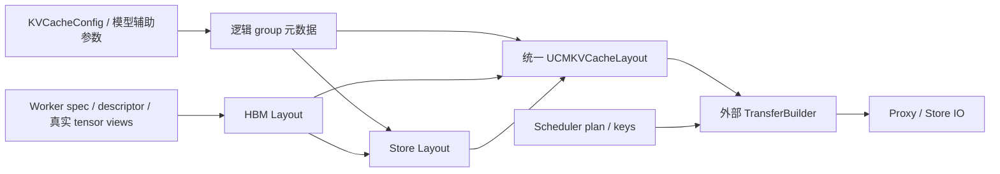
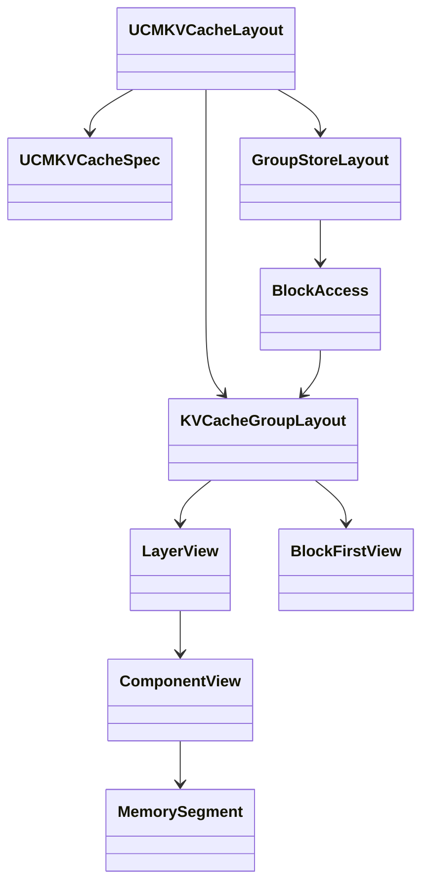

> 历史记录：本文是发布 [GitHub issue #1483](https://github.com/ModelEngine-Group/unified-cache-management/issues/1483) 时的 feature request 文稿，保留当时的设计建议。2026-10-12 的原生存取标志与 uint64 更新请以 [当前 Layout 详细设计](connector-v2-layout-design.md) 和对应代码快照为准。

# [Feature]: 统一基于 vLLM 0.30.0 的 KVCache Layout：配置解析、HBM 寻址与外存排布

### 🚀 The feature, motivation and pitch

#### 背景与问题

UCM 对接 vLLM 时，普通 attention、Mamba/KDA 混合模型以及 FA + SWA 模型分别由 `ucm_connector`、`hla_connector`、`hma_connector`（FAWA）处理。此前配置解析、设备缓存寻址和外存排布规则散落在三个 connector 中，存在重复实现，模型特例与传输生命周期相互耦合。

随着 vLLM 0.30.0 引入或调整多 group、压缩 attention、State cache、共享 backing 和 Block First 等布局，需要同时理解 CUDA 与 Ascend 的原生分配规则。仅凭 tensor shape 或模型名称推断地址，容易混淆逻辑 token 范围、物理 page 大小和外存记录大小；分别修改三个 connector 也会增加适配和维护成本。

建议提供统一的 **Layout 模块**，以 **vLLM 0.30.0 和对应 vLLM-Ascend main** 的接口为基础，明确以下三个职责。这里强调职责和统一入口，不要求强制拆成三个文件。

#### 1. KVCacheConfig：解析逻辑缓存元数据

- 统一解析原生 group/spec，保留 group ID、owner/layer 关系、缓存类型和逻辑 token 粒度。
- 描述 FA、SWA、State snapshot 的持久化与恢复规则，包括 tail 范围、UCM block size 和共同恢复边界。
- 明确区分需要持久化的缓存与可重建的 transient/scratch cache；不能仅凭 circular buffer 类型或容量整除就省略。
- scheduler 与 worker 共用逻辑解析入口；worker 物理绑定使用自身完整的 KVCacheConfig，避免用 scheduler 元数据猜测物理地址。

#### 2. HBM Layout：解析真实设备缓存布局

- 从 worker 注册的真实 `kv_caches`、原生 spec 和 descriptor 构建 `LayerView → ComponentView → MemorySegment`。
- 显式规范化 CUDA/Ascend 的 view 轴语义，再根据实际 shape、stride、dtype 和 data pointer 解析连续字节段；规范化 view 不重新分配 KV buffer。
- 统一 attention 与 State 的寻址公式：`base_ptr + block_id * block_stride + byte_offset`。State 的快照与等待语义仍由外部生命周期处理。
- 按 group 汇总 segments，提供 block IDs、token 范围和按层选择的字节寻址；部分 token 能力是 group 的整体策略。
- CUDA/CPU 在原生 layout 与 descriptor 满足条件时构建按 group 的 `BlockFirstView`；当前 NPU 使用逐层 segments，不从相同 layout enum 推断跨层 Block First。

#### 3. Store Layout：编译外存字节排布

- 为每个 group 构建 `GroupStoreLayout`，输出 offsets、sizes 和 `store_bytes`，明确 HBM 源偏移与外存目标偏移的区别。
- 通用路径按有效 payload 编排，支持异构 group、多个 components、部分 block 与 layerwise 存取，不继承 v1 store 的等 group 层数或 ghost padding 约束。
- 增加独立的整组快路径：仅在 `use_layerwise=False`、完整 block 且已有 `BlockFirstView` 时，使用 offset 0 + 整组 span；保留组内 page padding，不复制全局 block stride 中本组 span 之外的容量。
- `use_layerwise=True` 始终使用通用 payload 模板；按层选择保留该层在当前外存格式中的固定位置。
- 外存格式变化需要 namespace 隔离，避免错误复用旧记录。

#### 模块边界



Layout 只负责元数据、物理寻址和外存排布，不解析请求 plan、不生成 hash key、不管理 IO task，也不处理设备计算的 stream/event 时序。plan 与 keys 的关联、二维 Transfer 拼接、提交和等待由外部 scheduler、TransferBuilder、connector 与 proxy 负责。

#### 实现概要

目前实现放在 `ucm/integration/vllm/v2/layout/`，沿用 group/view 文件组织，按以下对象串起三部分职责：

| 对象 | 主要职责与数据 |
| --- | --- |
| `UCMKVCacheSpec / UCMKVCacheGroupInfo` | 逻辑 group、token block size、tail、State/transient 策略 |
| `UCMLayerSpec / TensorDescriptor` | 绑定 worker owner、原生 spec、物理存储大小及分配声明 |
| `LayerView / ComponentView` | 一个 layer_name 的一个或多个实际 tensor views，规范化轴并保留真实 strides |
| `MemorySegment` | 一个可连续搬运的范围，保存 base pointer、block stride 和有效 payload |
| `KVCacheGroupLayout / BlockAccess` | 展平整组 segments，编译 token 范围，批量计算运行时 block 地址 |
| `GroupStoreLayout` | 将物理内容映射到外存 offsets/sizes，选择通用或 Block First 模板 |
| `UCMKVCacheLayout` | 汇总逻辑 spec、group_layouts、store_layouts 和层索引 |



**注册阶段解析一次，运行阶段提供 block IDs。** 初始化先调用 `parse_kv_cache_config()` 得到逻辑元数据，再由 `build_group_layouts()` 将 worker 的 spec、descriptor 与真实 tensors 绑定，最后构建各 group 的外存模板。运行时 `compile_access()` 的结果保存固定块内 byte offsets/sizes，`resolve_ptrs()` 根据 block IDs 和可选 token offsets 计算地址；`resolve_matrices()` 输出按 key 组织的二维 offsets/ptrs/sizes。外部 `UCMTransferBuilder` 再关联 keys、累加参与 group 的外存起点并拼接 Transfer。

HBM 解析将非空 component 显式规范化为逻辑四维 BHNC，物理排布仍由 stride 决定：NHC 或单 head 可以按连续 token 切分；多个 head 的 compact HNC 可以整块合并，但当前不允许部分 token；跨 block/layer 间隔的 heads 按实际连续段展开。State 在 CUDA 上使用字节页 view，Ascend typed State 在入口转为保留原 storage 的字节页，再走同一套 segment 寻址。逻辑 token span、stored-state 数和物理 page 字节数分别处理，避免将压缩 KV 或 State 当成普通逐 token KV。

Store 的通用模板按有效 payload 的前缀和生成 offsets；多个原生 blocks 属于同一个 UCM key 时继续累计，`store_bytes` 表示该 key 下本组总大小。Block First bulk 是额外路径：单个原生 block 对应一项 offset=0、size=本组 span。比如两层有效内容为32B/16B，原生 page 含 padding 后为48B/32B，则 layerwise 模板保存48B有效内容，而符合条件的 bulk 模板保存80B组内 span。两种配置的存储格式分别隔离，不能互相套用 offsets。

**一个通用寻址例子**（教学参数，不是模型采集值）：同组两层每块8 tokens、每 token 分别4B/2B，base pointers 为1000/2000，block strides 为32B/16B。选择 block 3 内 `[2,6)` 的4个 tokens：

```text
ptrs         = [1000 + 3*32 + 2*4, 2000 + 3*16 + 2*2]
             = [1104, 2052]
sizes        = [16, 8]
store offsets= [0, 16]
store_bytes  = 24
```

这说明两类布局可以独立：HBM 中两层不必相邻，外存仍可紧凑排列。假设这个 key 的完整记录就是上述24B，仅访问第二层时目标 offset 仍为16，不改成0，整条记录大小也保持24B。

实现原则是在初始化阶段校验必要布局不变量，运行时保留真实越界检查；以明确的0.30.0接口为依据，不堆旧版本 fallback，不在每次 IO 中重复验证已编译的内部模板。

### Alternatives

1. 继续在三个 connector 中分别适配：改动局部，但重复规则容易再次分叉。
2. 仅统一 HBM 地址 helper：可以减少部分重复，却仍无法统一配置策略与外存记录格式。
3. 在 v1 固定 store 模板上增加 padding：可以作为旧路径的兼容方案，但不宜成为新的通用 Layout 契约。

推荐统一上述三个职责，同时保留清晰的传输与生命周期边界，供后续 connector 适配使用。

### Additional context

`dev_connector` 已有初步实现，入口位于 [v2/layout](https://github.com/ModelEngine-Group/unified-cache-management/tree/dev_connector/ucm/integration/vllm/v2/layout)，说明见 [Layout README](https://github.com/ModelEngine-Group/unified-cache-management/blob/dev_connector/ucm/integration/vllm/v2/layout/README.md)。主要对象为 `UCMKVCacheSpec`、`KVCacheGroupLayout`、`UCMKVCacheLayout` 和 `GroupStoreLayout`。

当前使用开发用 `SimpleFileUCMProxy`；变长 IO 与显式 commit 是 v2 的开发契约，生产 store/proxy 尚未接通。本轮 Layout 重构仅做静态检查，尚未完成运行验证；State layerwise 加载/计算流水也仍为待实现项。因此本 issue 描述的是统一设计与后续完善目标，不代表所有模型及后端已经验收。

后续验收建议覆盖：CUDA/Ascend 原生 view 寻址、异构多 group、压缩 KV 与 State、partial token、Block First padding、bulk/layerwise 外存格式，以及真实 load/dump 的字节一致性。特殊 ring 恢复、opaque/NZ packing 和重叠 buffer 应逐项核对，不默认视为已通用支持。
